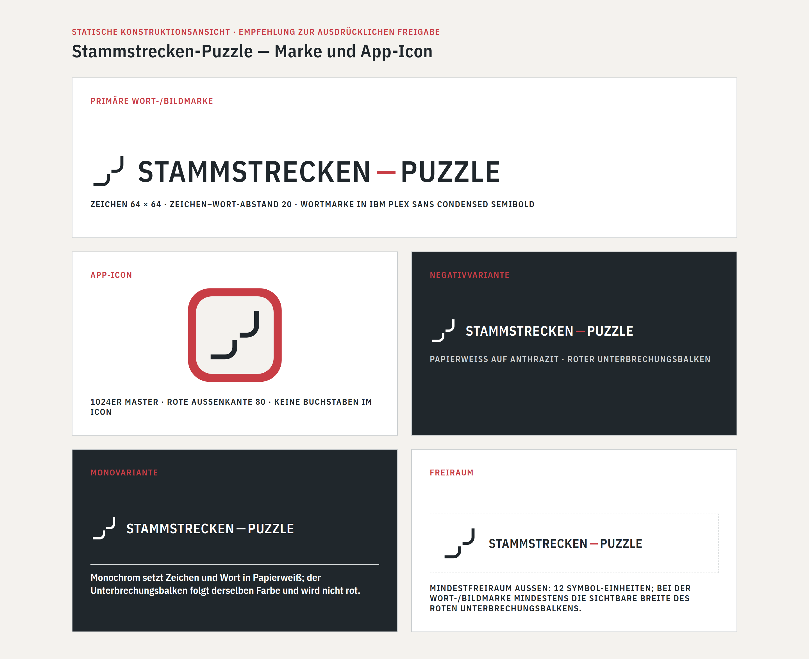
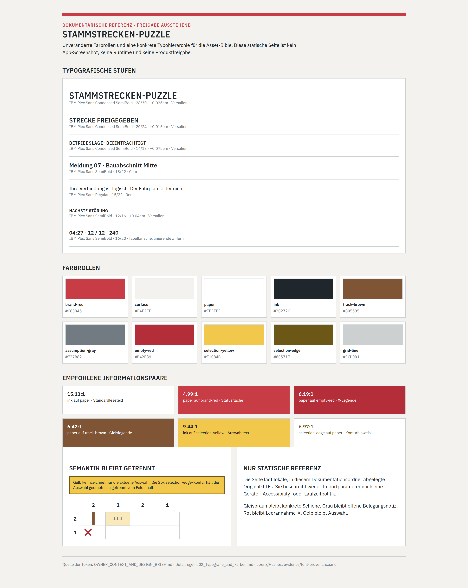
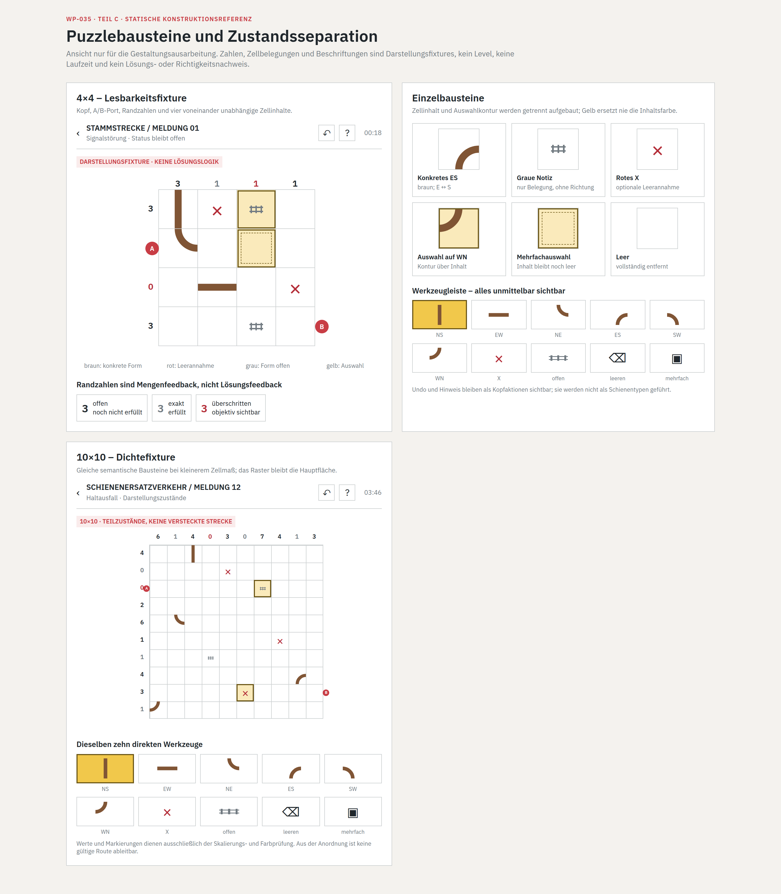
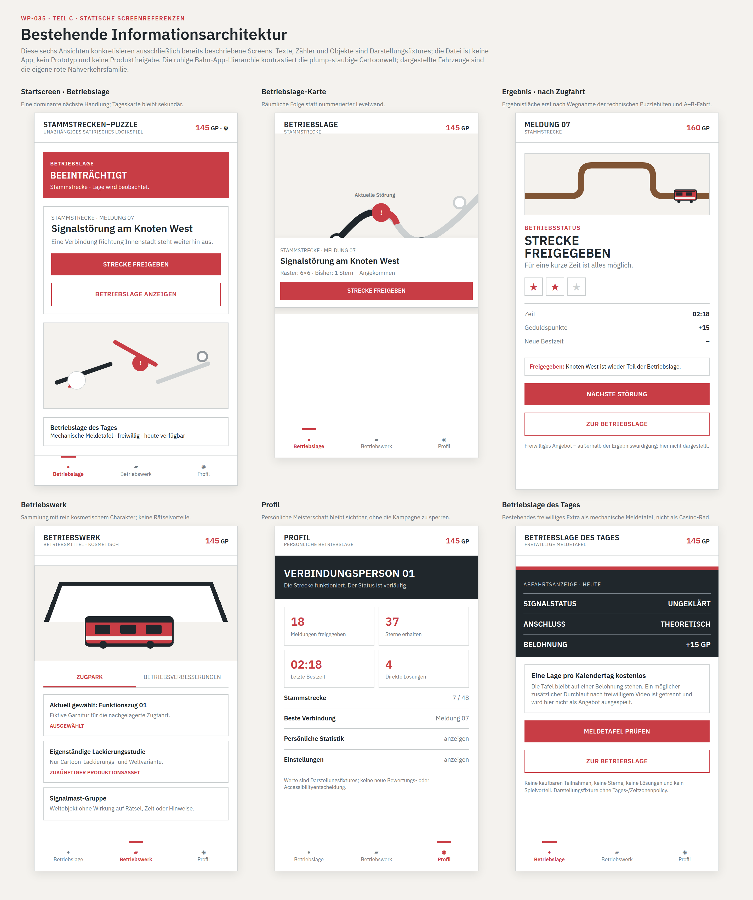
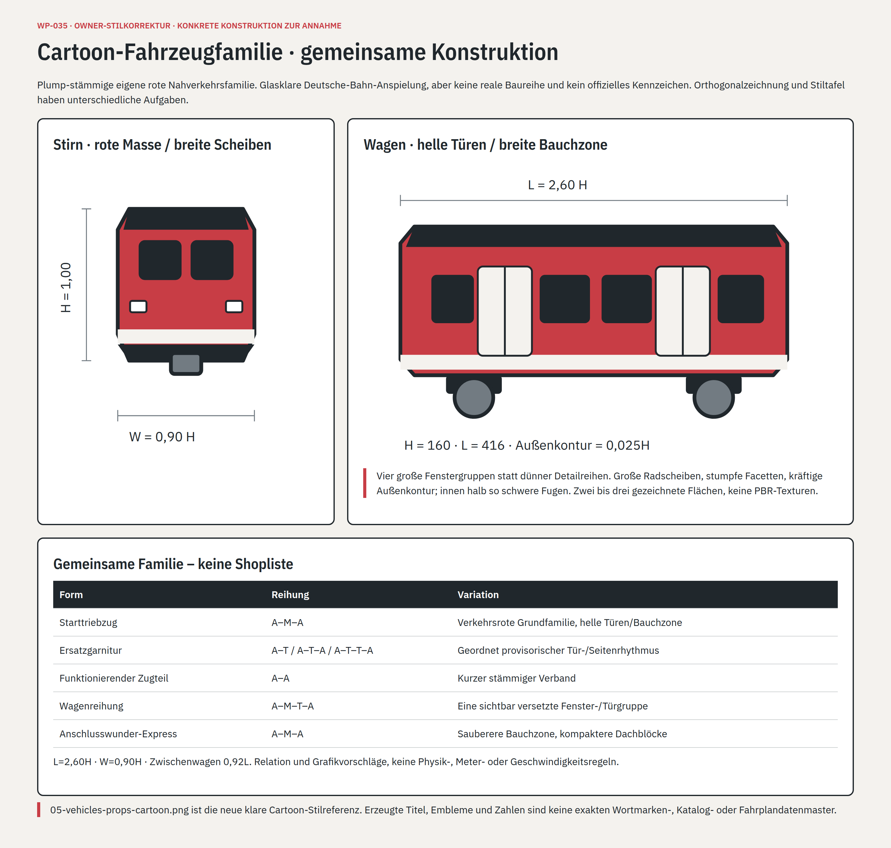
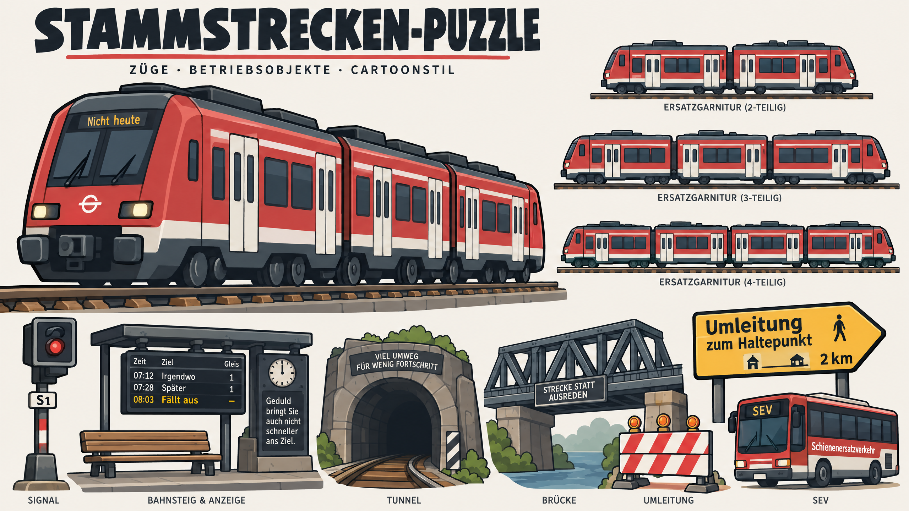
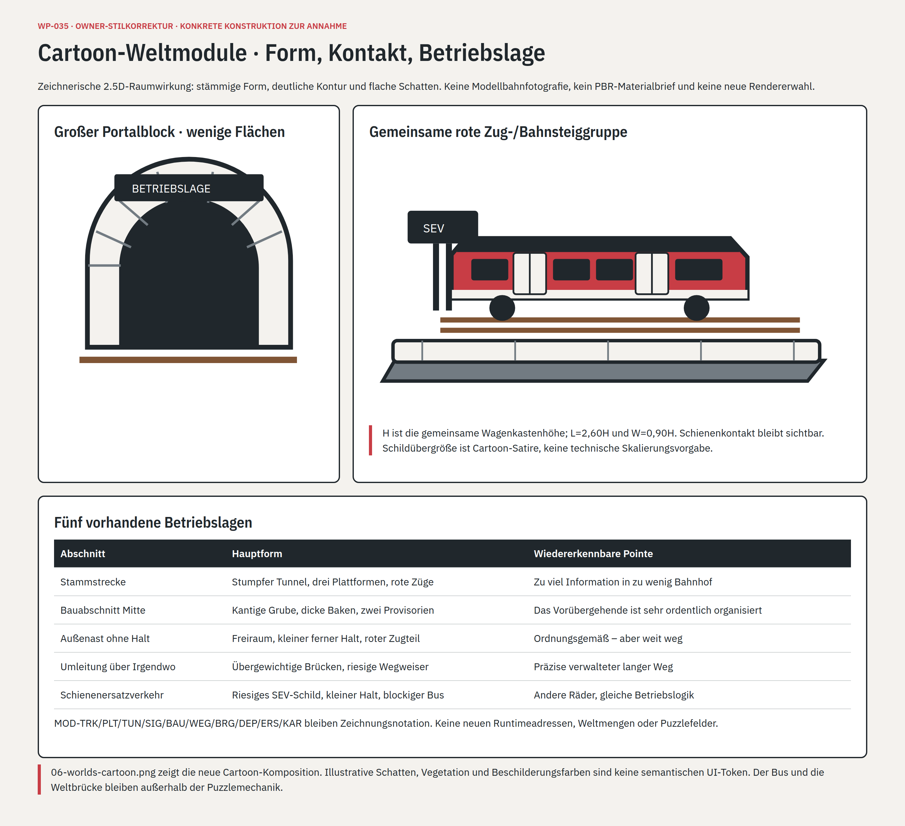
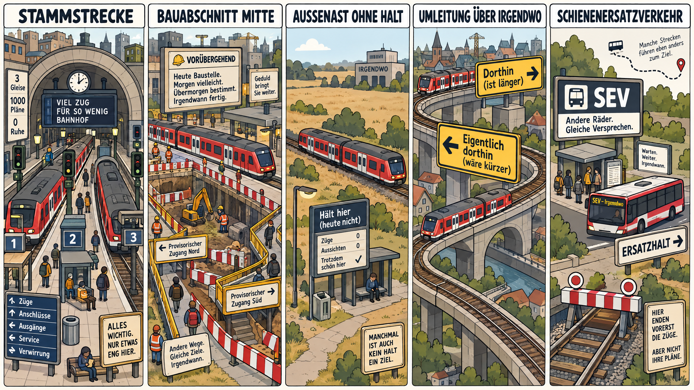
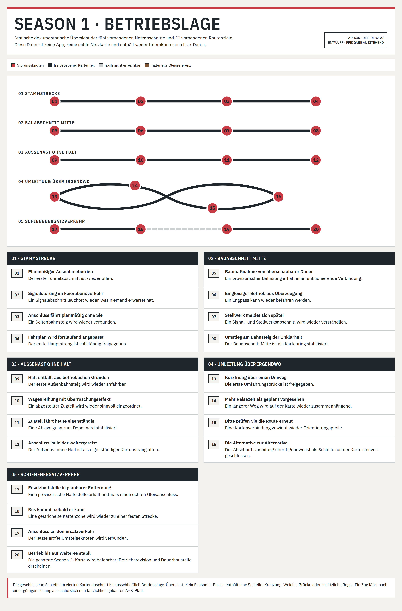
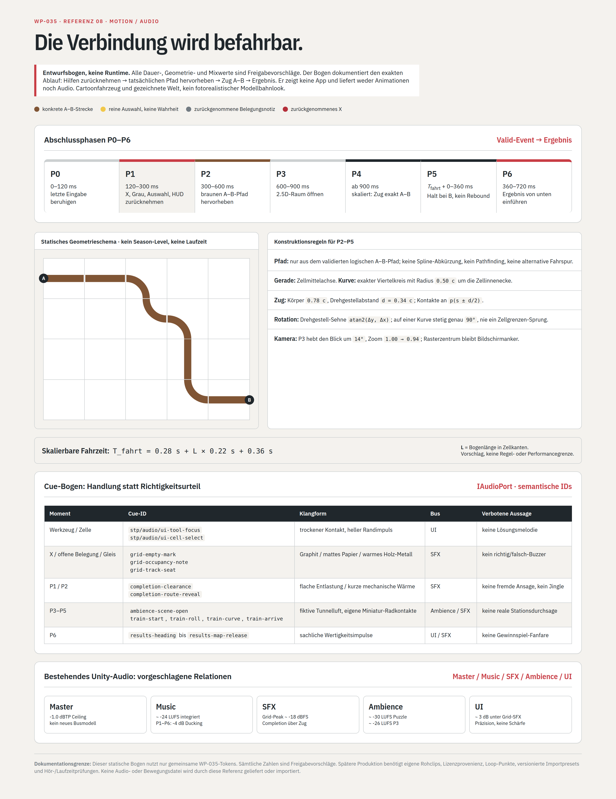

# Stammstrecken-Puzzle – vollständige Asset-Bible

**WP-035 · 17.10.2026 · zusammenhängende Gestaltungsempfehlung zur ausdrücklichen Freigabe**

Die sieben Fachkapitel und **zehn tatsächlich erzeugten Referenzansichten** liegen vor. Diese Datei ist der **eine Hauptreport**: Sie verbindet die Konstruktionen, zeigt die Gestaltung und führt zu allen Quellen, Lieferdateien und Nachweisen. Die Fachkapitel sind Bestandteile derselben Bible, keine voneinander unabhängigen Alternativentwürfe.

**Status:** Owner hat die erste visuelle Richtung ausdrücklich zurückgewiesen. Die Bible ist auf Cartoon-/Comic-Stil mit glasklarer Deutsche-Bahn-Anspielung korrigiert; die konkrete neue Ausführung ist nicht automatisch angenommen. Frühere technische PASS-Belege sind keine Stilfreigabe und gelten nicht als Nachweis dieses Korrekturstands. Das Work Package bleibt offen. **Keine Produkt-, Rechts-, Runtime- oder Releasefreigabe. Kein Merge nach main.**

## 1. Was jetzt konkret vorliegt

| Bereich | Konkrete Ausarbeitung | Fachquelle |
|---|---|---|
| A · Marke und Icon | Eigenständiger unterbrochener Gleisknoten mit exakten Pfaden, Wort-/Bildsatz, Hell-/Negativ-/Monoregeln und 1024er Icon-Master. | [01 – Marke und App-Icon](01_Marke_und_App-Icon.md) |
| B · Schrift und Farbe | Zehn exakte Token, Typohierarchie und Zahlenformatierung; drei unveränderte Original-TTFs mit gepinnter IBM-Herkunft, Lizenztext und Hashes. | [02 – Typografie und Farben](02_Typografie_und_Farben.md) |
| C · UI und Puzzle | Sechs Halbkantenzentrum-Gleisformen, X/Grau/Auswahl, A/B, objektive Zählzustände und direkte Werkzeuge; 4×4-/10×10-Referenzen und sechs bestehende Screenansichten. | [03 – UI und Puzzlebausteine](03_UI_und_Puzzlebausteine.md) |
| D · Fahrzeuge und Objekte | Gemeinsame fiktive Nahverkehrsfront, Fenster-/Tür-/Lack-/Laufwerkmodule, fünf kosmetische Familien, Betriebsobjekte und Reduktionen für Karte/Fahrt/Betriebswerk. | [04 – Züge, Lackierungen und Betriebsobjekte](04_Zuege_Lackierungen_und_Betriebsobjekte.md) |
| E · Welt und Karte | Gemeinsamer Modulmaßstab, Materialien/Licht/Kontaktregeln, fünf bestehende Netzabschnitte und konkrete Kompositionsbriefe für ihre 20 vorhandenen Routenziele. | [05 – Welt- und Kartenmaterial](05_Welt_und_Kartenmaterial.md) |
| F · Motion und Sound | Eingabe-/Undo-/Abschlussphasen, pfadabgeleitete A–B-Fahrt, Kurven-/Kamerakonstruktion, Ergebnis-/Kosmetikpräsentation und semantische Cue-/Mix-/Rohformatbriefe. | [06 – Motion und Sound](06_Motion_und_Sound.md) |
| G · Produktionsübergabe | 40 nachverfolgbare Anforderungen mit Varianten, Zuständen, tatsächlichen Referenzen, Zielklassen und späterem Import-/Lizenz-/Lokalisierungsbedarf. | [07 – Produktionsinventar und Übergabe](07_Produktionsinventar_und_Uebergabe.md) |

Die Lieferung enthält keine Modelle, Texturen, Audiodateien, Animationen oder Unity-Imports. HTML- und SVG-Dateien sind **statische Konstruktionsquellen**, keine Demo-App oder alternative Spiel-Laufzeit. Alle Referenzen befinden sich außerhalb von `Assets/` und `Content/`.

## 2. Die eine gemeinsame Richtung

**Direkte Ownerfestlegung:** „stlisierten Cartoon- / Comic- Grafikstil“, „plump-staubig-behördenhaftere“ Anpassung und „GLASKLARER DEUTSCHE-BAHN ANSPIELUNG. Das ist der KERN“. [Herkunft und eigener Fehler](evidence/OWNER_STYLE_CORRECTION_2026-10-17.md) sind dokumentiert. Die abgelehnten Realismusbilder sind aus der aktuellen Lieferung entfernt und wurden nicht als Eingabereferenzen wiederverwendet.

**Konkrete Art Direction:** bewusst stämmige verkürzte Formen, kräftige klare Konturen, zwei bis drei gezeichnete Schattenflächen, sparsame grafische Patina. Verkehrsrote Nahverkehrszüge, helle Tür-/Bauchzonen, dunkle Dach-/Fenstergruppen, Bahn-App-/Bahnsteig-Duktus und SEV bleiben sofort erkennbar. Keine Modellbahnfotografie, kein Pseudorealismus und kein generischer Cozy-/Fantasy-Zugstil. Clash of Clans/Candy Crush sind Qualitäts-/Stilbeispiele, keine Kopiervorlagen.

**Stammstrecken-Puzzle** bleibt sehr nah an der vertrauten deutschen Bahnfahrerwelt: Rot, Weiß und Anthrazit, sachlich verdichtete Information, straffe Typografie, Betriebslagen und überpräzise Provisorien. Diese Nähe wird nicht zu beliebiger, vorsichtig entfernter Bahnsatire abgeschwächt. Die konkrete Ausführung nutzt aber **eigene Zeichen, eine eigene Fahrzeugfront, eigene Texte und eigene Konstruktionen**.

Das Rätsel ist zuerst eine ruhige technische Arbeitsfläche. Nach der gültigen Verbindung tritt der tatsächliche Pfad hervor, der Zug fährt ihn ab und erst danach erscheint das Ergebnis. Die sorgfältig gezeichnete Cartoon-Spielwelt gibt dieser Leistung Gewicht. Die dienstliche Informationsoberfläche ist ihr bewusstes Gegenstück; der Denkbereich bleibt ruhig. Schienenersatzverkehr ist mit Buskulisse, überdimensionierter Ersatzbeschilderung, langem Fußweg und sauber verwalteten Absperrungen ein sichtbarer Lore-Kern – kein austauschbares Dekor und keine neue Puzzlemechanik.

### Herkunft und Autorität

Der [Owner-Kontext und Designbrief](evidence/OWNER_CONTEXT_AND_DESIGN_BRIEF.md) hält den ausdrücklichen Auftrag, seine Grenzen und die rekonstruierte Ursprungslore fest. Die persistenten Fachquellen sind [Konzept 10](../../../Stammstrecken_Puzzle_Konzept_00-15/10_Visuelle_Identitaet_und_Stammstrecke.md), [Konzept 11](../../../Stammstrecken_Puzzle_Konzept_00-15/11_Bahnfahrer_Lore_und_Satire_Leitplanken.md), [Konzept 12](../../../Stammstrecken_Puzzle_Konzept_00-15/12_UI_und_Bedienungsspezifikation.md) und die [Season-1-Content-Bible](../../../Stammstrecken_Puzzle_Konzept_00-15/14_Season_1_Content_Bible.md). Ihre bestätigten Vorgaben wurden nicht überschrieben. Die neuen konkreten Maße und gestalterischen Ausführungen sind ausdrücklich **Vorschläge zur Annahme**, keine konkurrierende Source of Truth.

[Content Pipeline](../../../ARCHITECTURE/CONTENT_PIPELINE.md), [Technology Stack](../../../ARCHITECTURE/TECH_STACK.md), [Content Catalogs](../../../ARCHITECTURE/CONTENT_CATALOGS.md) und die vorhandene [Teststrategie](../../../ARCHITECTURE/TEST_STRATEGY.md) bleiben der spätere technische Rahmen. Neue Pipeline, Rendererwahl, Paketversionen, Performancegrenzen und zusätzliche Abnahmerollen wurden nicht eingeführt.

## 3. Marke und App-Icon – konkret sichtbar

**Vorschlag:** Der unterbrochene Gleisknoten besteht aus zwei offenen, rechtwinklig geführten Strecken auf einer 96×96-Fläche. Strichbreite 8, Radius 16; die Endpunkte `(48,60)` und `(60,48)` bleiben getrennt. Die offene Verbindung ist die Aussage des Zeichens, kein offizielles Monogramm und kein Spielzustand.

Die Wortmarke wird in **IBM Plex Sans Condensed SemiBold** mit +0,026em einzeilig gesetzt. Ein eigener roter Unterbrechungsbalken trennt STAMMSTRECKEN und PUZZLE. Das 1024er Icon verbindet den identischen Knoten mit einer warmen hellen Innenfläche und eigenständiger roter Rahmenkonstruktion.

**Exakte Quellen:** [Zeichen-SVG](references/brand-symbol.svg), [Icon-SVG](references/app-icon.svg), [Markenkonstruktionsansicht](references/01-brand.html). Die Bildansicht oben ist aus dieser lokalen Quelle mit der tatsächlichen Originalschrift gerendert.

## 4. Typografie und Farbsystem

| Token | Wert | Gemeinsame Rolle |
|---|---|---|
| brand-red | `#C83D45` | Marke, Betriebslage und aktueller Störungsakzent |
| surface | `#F4F2EE` | Warme äußere Informations- und Materialfläche |
| paper | `#FFFFFF` | Raster, Karten- und Kontrollfläche |
| ink | `#20272C` | Primärtext, technische Struktur und freigegebener Kartenstrang |
| track-brown | `#805535` | Konkrete Gleisformen und deren materielle Schienenreferenz |
| assumption-gray | `#727B82` | Offene Belegungsnotiz; objektiv exakt erfüllte Randzahl |
| empty-red | `#B42E39` | Optionale Leerannahme-X; objektive Mengenüberschreitung |
| selection-yellow | `#F1C84B` | Nur Werkzeug-/Zellauswahl; keine Belohnung oder Lösungsfarbe |
| selection-edge | `#6C5717` | Geometrische Auswahlkontur |
| grid-line | `#CCD0D1` | Ruhige Raster- und Trennlinien |

**IBM Plex Sans Regular/SemiBold** trägt Informationen, Werkzeuge und Zahlen; **IBM Plex Sans Condensed SemiBold** die straffen Auszeichnungs- und Statusstufen. Zahlen benutzen tabellarische, linierende Ziffern. Der Primärmarkensatz hat 52 px; die kompakte Wortmarke 28/30 px. Kapitel B enthält die übrigen reproduzierbaren Stufen und die berechneten Kontrastpaare. Diese Werte ersetzen keine offene Geräte-/Accessibilityentscheidung.

**Tatsächlicher Lizenznachweis:** Die drei Original-TTFs stammen aus `IBM/plex` am gepinnten Commit `71f558992315a12ca1f06a2215d57962a1992162`. Dateiversionen, Original-URLs, Bytes und SHA-256 stehen in der [Font-Provenienz](evidence/font-provenance.md); die [unveränderten OFL-1.1-Originalbytes im ZIP](evidence/font-license-original.zip) und eine [lesbare Textkopie](evidence/font-license-original.txt) sind beigefügt. Einbettung und Weitergabe sind nach dem Lizenztext unter Bedingungen erlaubt; Hinweise müssen erhalten bleiben, Schriftdateien dürfen nicht für sich allein verkauft werden, Änderungen benötigen neue Provenienz. Eine solche dokumentierte Lizenzlage ist nicht mit Marken-, Store- oder Produktionsfreigabe gleichzusetzen.

**Quellen:** [Typo-/Farbreferenz](references/02-type-color.html), [Token-JSON](references/design-tokens.json), Originalschriften unter `references/Fonts/`.

## 5. Raster und bestehende Oberfläche

**Ein geometrischer Satz:** NS, EW, NE, ES, SW und WN beginnen und enden auf normierten Halbkantenzentren. Strich 18/100, Viertelkreisradius 50/100, bündige Enden. Die Skalierung ändert diese Portlage nicht. Die graue Belegungsnotiz ist ein **kleines kantenfreies Standardgleis**, keine graue Gerade oder Kurve mit Anschlüssen. X, Grau und konkrete Form bleiben austauschbare Feldinhalte; Gelb ist eine unabhängige Auswahlhülle.

Der Vorschlag verwendet auf Zellen 38 % Gelb über Papier mit innenliegender Kontur; Werkzeuge erhalten volle gelbe Fläche. Das 10×10-Fixture benutzt denselben Gleissatz und dieselben zehn direkten Feldwerkzeuge wie die kleine Referenz. Diese Layoutgrößen sind keine heimlich beschlossenen Gesten-, Touch-, Orientierungs- oder Accessibilityregeln.

**Zählzustände** entstehen ausschließlich aus der tatsächlich gezeigten Belegung einschließlich grauer Notizen. Ein exakt erfüllter Zähler behauptet keine richtige Gleisgeometrie oder richtige Lösung. Die Beispiele sind Darstellungsfixtures, keine beauftragten oder proofgeprüften Season-Level.

Die Screenstruktur bleibt unverändert. Außerhalb des Rätsels führen die drei Hauptziele zu **Betriebslage, Betriebswerk und Profil**; die Tagesmeldung ist kein viertes Hauptziel. Im aktiven Rätsel gibt es keine Geld-, Werbe-, Bonus-, Betriebswerk- oder untere Hauptnavigation. Beispieltexte und Zahlen sind keine finale Textbibliothek, Preis-, Kalender- oder Bewertungsentscheidung.

**Quellen:** [Sechs Gleisformen-SVG](references/track-shapes.svg), [Puzzlequelle](references/03-puzzle.html), [Screenquelle](references/04-screens.html).

## 6. Fahrzeugfamilie und Betriebsobjekte

**Vorschlag:** Ein eigener stämmiger **verkehrsroter** Nahverkehrskasten mit zwei getrennten breiten Scheiben, großen einfachen Tür-/Fenstergruppen, hellen Türen/Bauchzone und dunkler Dach-/Laufwerkmasse. Kräftige Kontur und wenige gezeichnete Flächen statt realistischer Details. Die gemeinsame Wagenkastenhöhe ist H, die Länge L=2,60H, die Breite W=0,90H. Das sind Konstruktionsrelationen, keine reale Baureihe, kein Collider und kein Metermaß.

Fünf Formen – Starttriebzug, modulare Ersatzgarnitur, funktionierender Zugteil, Wagenreihung und Anschlusswunder-Express – variieren Reihung und Lackrhythmus innerhalb derselben Familie. Ihre Arbeitsnamen sind **keine finalen Katalog-IDs, Preise oder Freischaltungen**.

Signal, Weltweiche, Bahnsteig, Bank, Meldetafel, Wegweiser, Portal, Brücke, Ersatzhaltestelle, Absperrung und Busmotiv bilden einen wiederverwendbaren Baukasten. Weiche, Brücke, Signal und Bus sind ausschließlich kosmetische Weltobjekte – keine Season-1-Felder, Werkzeuge oder alternativen A–B-Pfade.

**Wichtige Nutzungsgrenze:** Die neue Tafel vermittelt den korrigierten Cartoonstil und die klare Bahn-Anspielung, ist aber nicht maßhaltig. Einzelne Signal-, Portal-, Front- und Propdetails sind illustrative Varianten. Die exakte Gestaltungsvorlage ist Kapitel D zusammen mit der [Fahrzeugkonstruktionsquelle](references/05-vehicles-construction.html), nicht die ungeprüfte Übernahme jedes AI-Details. Der [Fahrzeugbildbrief](evidence/vehicle-image-brief.md) hält die eigene Herkunft fest.

## 7. Fünf Welten, ein zusammenhängendes Kartenmaterial

**Vorschlag:** Alle Raumbausteine benutzen H aus der Fahrzeugkonstruktion als gemeinsame Moduleinheit. Bahnsteig, Gleis, Signalmast, Baugrube, Weg, Brücke, Depot und Ersatzhaltestelle besitzen konkrete Modul-, Kontakt- und Materialregeln. Die fünf Abschnitte differenzieren sich über Komposition und Betriebslage, nicht über neue Puzzlemechanik. Illustrative Schatten-/Boden-/Beschilderungs-/Vegetationsfarben sind keine zusätzlichen UI-Zustände.

1. **Stammstrecke:** Tunnel und drei Bahnsteige bilden den engen, zuerst prägenden Betriebsknoten.
2. **Bauabschnitt Mitte:** Baugrube, kontrollierte Absperrung und zwei provisorische Wege erzeugen verwaltete Umständlichkeit.
3. **Außenast ohne Halt:** Distanz entsteht über freien Raum, Randbahnsteig, Gewerbevolumen und Depot.
4. **Umleitung über Irgendwo:** Versetzte Brücken und widersprüchlich wirkende Wegweiser machen die Rückführung räumlich sichtbar.
5. **Schienenersatzverkehr:** Ersatzhalt, langer Fußweg und Buskulisse stehen einer flachen gestrichelten Kartenlücke gegenüber. Der Bus ersetzt keine Zugfahrt im Rätsel.

Die neue Tafel ist eine Cartoon-Stil-/Raumreferenz, keine exakte Font-, Shader-, Objekt- oder Maßautorität. Vegetation und Beleuchtung begründen keine neuen UI-Token. Für Produktionskonstruktion gelten Teil E und die [Weltkonstruktionsquelle](references/06-world-construction.html). Der [Weltbildbrief](evidence/world-image-brief.md) dokumentiert die Herkunft und die Illustrationsgrenze.

**Alle 20 Routenziele** sind aus der vorhandenen Content-Bible übernommen und mit konkreten Modulen und Kartenkompositionen verbunden. Eine Karten-Schleife ist nur Übersichtssymbolik; die Rätsel bleiben einzelne schleifenfreie A–B-Verbindungen. Die Übersicht zeigt Routenbausteine, nicht einen behaupteten aktuellen Spielstand oder eine reale Netzkarte.

**Quelle:** [20-Routenübersicht](references/07-route-map.html); die einzelnen Kompositionsbriefe stehen in Kapitel E.

## 8. Motion und Klang – konkret vorbereitet, nicht als Medien erfunden

**Bestätigte Reihenfolge:** Hilfen zurücknehmen → tatsächlich gebauten Pfad hervorheben → Zug von A nach B → Ergebnis.

**Vorschlag zur Inszenierung:** P0–P3 bereiten die Fahrt bis 900 ms vor. Die Fahrt skaliert mit der tatsächlichen Bogenlänge; die Drehgestelle liegen auf demselben aus dem gültigen logischen Pfad abgeleiteten Anschlussschema. Viertelbögen werden nach Bogenlänge durchlaufen. Der Zugkörper ist in der Puzzlefahrt 0,78C lang und 0,27C breit. Kein Physics-, Spline- oder Kamerasystem erzeugt einen Ersatzweg.

Der Cue-Brief unterscheidet X, offene Belegung, konkrete Schiene, Auswahl und Undo über Materialcharakter, **nicht über richtig/falsch**. Die vorhandenen Unity-Mixergruppen Master, Music, SFX, Ambience und UI bleiben bestehen. Kapitel F konkretisiert relative Pegel, Fade-/Loopbedarf und 48-kHz-/24-bit-PCM-Quellen als spätere Produktionsvorschläge.

**Geliefert:** [Statischer Phasen-/Cue-Bogen](references/08-motion-audio.html), Zeiten, Geometrie- und Klangbriefe. **Nicht geliefert:** Animation, Audiodatei, Aufnahme, Hörtest oder funktionsfähige Fahrt. Die schematische Bildstrecke demonstriert exakte Anschlüsse, ist aber kein Season-Level und kein neuer Spielmodus.

## 9. Produktionsinventar und technische Übergabe

Das [Anforderungsinventar mit 40 Zeilen](evidence/asset-requirements.csv) enthält Zweck, Varianten, Zustände, **tatsächliche Referenzdateien**, spätere Zielklasse, Import-/Meta-, Lizenz-/Versions- und Lokalisierungsbedarf. Die IDs verfolgen Anforderungen; sie sind keine Produkt-, Preis-, Unlock- oder Localization-Keys.

| Ebene | Jetzt geliefert | Später separat zu erzeugen/prüfen |
|---|---|---|
| Dokumentation | Hauptreport, sieben Kapitel, Bildbriefe, Inventar und Nachweise | Nachführung nach ausdrücklichen Entscheidungen |
| Exakte Referenzquellen | Drei SVGs, acht statische HTML-Quellen, Token-JSON | Freigegebene Produktionsableitungen |
| Sichtbare Referenzen | Zehn PNGs: acht lokale Renderings und zwei originale Cartoon-Stiltafeln | Runtimefähige Sprites, Modelle, Materialien und UI-Assets |
| Schrift | Drei unveränderte IBM-Plex-TTFs plus Original-Lizenz und Hashes | Tatsächlicher Fontimport, Hinweise, Glyphen-/Zielgeräteprüfung |
| Motion/Audio | Phasen-, Pfad-, Cue-, Mix-, Rohformat- und Loopbriefe | Eigenständige lizenzierte Medien, Schnitt, Loops, Import und Hörprüfung |
| Unity/Addressables | Vorhandene Zielklassen, Gruppen und `stp/<domain>/<stable-id>` als Rahmen | `.meta`, konkrete versionierte Importpresets, reale Adressen/Katalogbindungen |

Die bestehenden Architekturregeln werden übernommen, aber nicht vorkonfiguriert. Im gelesenen Bestand fehlen konkrete Importpresets und eine festgelegte LFS-Schwelle; diese späteren technischen Entscheidungen wurden nicht erfunden. Finale Textbibliothek, Verkaufskatalog, Preise, Freischaltungen, menschliche Spieltests, Zeitkalibrierung und Release bleiben getrennte bestehende Blöcke.

## 10. Prüfung und tatsächliche Grenzen

Die erste Sichtprüfung hat die Art Direction verfehlt: die Bilder waren pseudo-realistisch, obwohl Fotorealismus bereits ausgeschlossen war. Datei-/Hash-/Scope-PASS ist kein Nachweis der gestalterischen Eignung. Diese Korrektur ist ausdrücklich keine automatische Produktannahme.

Die korrigierte Datei-/Link-/Inventarprüfung sowie der [lokale Korrekturstand-Architecture-/Scope-PASS](evidence/architecture-cartoon-local-pass.txt) sind bestanden. Dies ist technische Eigenprüfung, keine Annahme der neuen Gestaltung. Die [Konsistenz- und Eigenprüfungsnotiz](evidence/DESIGN_CONSISTENCY_AND_VALIDATION.md) dokumentiert die Zusammenführung und korrigierten Referenzfehler. Die [A–G-Quellenmatrix](evidence/COVERAGE_MATRIX.md) und der [historische lokale Architecture-/Scope-PASS vor der Stilkorrektur](evidence/architecture-local-pass.log) ergänzen den Nachweis. Maschinenlesbare Belege liegen in [Lieferprüfung](evidence/delivery-validation.json), [Renderprotokoll](evidence/render-results.json) und [Dateimanifest](evidence/file-manifest.json). Die eigene Prüfung ist keine unabhängige Abschlussfreigabe.

Reproduktion der statischen PNGs: `python3 build_references.py`; konkrete Lieferprüfung: `python3 validate_delivery.py`. Benötigt werden Chromium, Python Playwright, Pillow, fontTools und BeautifulSoup in der Arbeitsumgebung; keine Repositorypaket- oder Produktionsabhängigkeit wurde ergänzt. Der unveränderte Architekturvalidator wird separat mit seiner gepinnten Python-3.11.13-/Lockfile-Umgebung und dem eigenen WP-035-Manifest ausgeführt.

**Reguläre CI:** Der vorhandene Architekturworkflow ist noch auf WP-027 eingestellt. Workflowänderungen sind nicht beauftragt und bleiben aus. Eine dadurch scheiternde CI-Prüfung wird ehrlich als fehlender Abschlussnachweis dokumentiert, nicht umgangen und nicht zum pauschalen Projekt- oder Designstartblocker gemacht. Die konkreten Läufe, Head-Bezüge und Ergebnisse stehen nach Ausführung im Work Package und am eigenen Draft-PR.

Kein menschlicher Spiel-/Hörtest, kein Geräte-/Accessibilitynachweis, keine Markenrechtsprüfung, keine Unity-Importprüfung und keine Releasefreigabe werden behauptet. Keine fremden Arbeitszweige, die 240 Rätsel oder ihre Proofs wurden verändert oder integriert.

## 11. Tatsächlich erforderliche Entscheidungen – an konkreten Ergebnissen

| Entscheidung | Vorgelegter Vorschlag | Wirkung bei Annahme / Änderung |
|---|---|---|
| **D-01 · Gemeinsames System** | Zehn Token und IBM-Plex-Sans/Condensed-System aus Abschnitt 4. | Annahme macht die neuen konkreten Typo-/Geometriewerte zur einheitlichen Gestaltungsbasis. Änderungen werden durch alle betroffenen Quellen und Referenzen nachgezogen. |
| **D-02 · Marke/Icon** | Unterbrochener Gleisknoten, einzeilige Wortmarke und Icon aus Abschnitt 3. | Annahme bestimmt den visuellen Master. Änderung betrifft Pfade, Freiraum oder Satz, nicht Produktname oder nahe Bahnfahrerpositionierung. Eine spätere Rechtsprüfung bleibt getrennt. |
| **D-03 · Puzzle/UI** | 100er Gleisgeometrie, kantenfreie graue Note, getrennte Auswahl und bestehende Screenlayouts aus Abschnitt 5. | Annahme konkretisiert die Darstellung. Keine Annahme von Gesten, Orientierung, Accessibilitypolitik oder verstecktem Lösungsfeedback. |
| **D-04 · Kosmetische Welt** | plumpe eigene rote Nahverkehrsfront, helle Türen/Bauchzone und Cartoonkonstruktion, Betriebsobjekte und fünf vorhandene Raumkompositionen aus Abschnitt 6/7. | Annahme macht die exakten Konstruktionen zur Produktionsvorlage. AI-Tafeln bleiben illustrative Cartoon-Stilreferenzen; keine Shop-/Katalog-/Preis-/Freischaltfreigabe. |
| **D-05 · Motion/Klang** | Phasen-, Pfad-, Cue- und Mixempfehlung aus Abschnitt 8. | Annahme konkretisiert spätere Medienproduktion unter bestehender Abschlussreihenfolge; keine bereits gelieferten Medien, keine Wertungs-/Zeitgrenzen. |
| **D-06 · Produktionsanschluss** | Vor einem tatsächlichen Import konkrete Presets, Schrift-Hinweisplatzierung und LFS-Schwelle innerhalb der vorhandenen Architektur bestimmen. | Noch offene technische Details bleiben echte Folgeentscheidungen. Sie sind keine Voraussetzung, die diese konkret vorgelegte Entwurfsausarbeitung rückwirkend verhindert. |

**Sinnvoller nächster Schritt:** Die zusammenhängende Empfehlung an diesen Ergebnissen ausdrücklich annehmen oder gezielt ändern. Danach werden freigegebene Quellen innerhalb der bereits vorgesehenen Produktionsblöcke genutzt. Kein Projektneuplanning, keine automatisch gestartete Implementation, keine zusätzliche erfundene Abnahmeserie und keine Übertragung fremder PASS-Aussagen.

## 12. Persistente Fundstellen

- [Eigenes WP-035](../../../WORK_PACKAGES/WP-035_Finale-Asset-Bible-Ausarbeitung.md) mit Status, Anker, Tests und Übergabe.
- [Unverändertes Scope-Manifest](../../../tools/architecture-validation/scopes/WP-035.documentation.scope.json).
- [Projektstatus](../../CURRENT_STATE.md) und [Arbeitswarteschlange](../../WORK_QUEUE.md): additive branchlokale Asset-Bible-Hinweise; ältere Main-Abschnitte bleiben historische Integrationsaussagen.
- [Vollständiges Produktionsinventar](evidence/asset-requirements.csv) und [Dateimanifest](evidence/file-manifest.json).

**Branch:** `design/wp-035-finale-asset-bible` auf verifizierter Mainbasis `d90e798dd9b26d3f152f3b0c2d1d52cae641eb16`. PR und finaler Head werden mit den tatsächlichen CI-Nachweisen in der persistenten Übergabe ergänzt. [Draft-PR #30](https://github.com/Al1l1l1l1l1/Stammstrecken-Puzzle/pull/30) ist die persistente Veröffentlichung des eigenen Entwurfs; kein Merge. Die Branch ist eine Gestaltungslieferung, keine Änderung der integrierten Produktgrundlagen.
